# Galerie des objets et blocs — Realms Reforged

Découvrez les **31 textures d'objets** et les **26 textures de blocs** extraites du JAR 1.13.1 / 26.x. Les images originales des golems, compagnons, créatures et boss **ne sont pas publiées dans le wiki**, pour conserver le plaisir de les découvrir dans Minecraft.

L'auteur choisira lui-même les captures de créatures à partager sur [CurseForge](https://www.curseforge.com/minecraft/mc-mods/realms-reforged). Leurs mécaniques restent décrites dans [Golems](Golems-FR.md) et [Créatures, boss et compagnons](Creatures-et-compagnons-FR.md).

## Objets / Items (31)

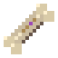 `ancient_bone`  
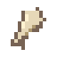 `bone_fragment`  
 `cursed_bone`  
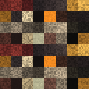 `demon_horn`  
 `diamond_crowned_helmet_1`  
 `diamond_crowned_helmet_2`  
 `diamond_crowned_helmet_3`  
 `diamond_crowned_helmet_4`  
 `diamond_crowned_helmet_5`  
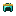 `diamond_crowned_helmet_6`  
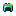 `diamond_crowned_helmet_7`  
 `ghoul_fang`  
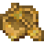 `golden_boat`  
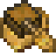 `golden_chest_boat`  
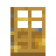 `golden_door`  
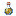 `golden_elixir`  
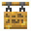 `golden_hanging_sign`  
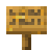 `golden_sign`  
 `golden_stick`  
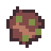 `improved_rotten_flesh`  
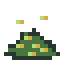 `master_tnt_powder`  
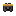 `netherite_crowned_helmet_1`  
 `netherite_crowned_helmet_2`  
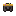 `netherite_crowned_helmet_3`  
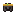 `netherite_crowned_helmet_4`  
 `netherite_crowned_helmet_5`  
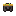 `netherite_crowned_helmet_6`  
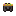 `netherite_crowned_helmet_7`  
 `restoration_stone`  
 `splash_golden_elixir`  
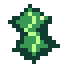 `unstable_heart_fragment`  

## Blocs / Blocks (26)

 `charged_tnt_bottom`  
 `charged_tnt_side`  
 `charged_tnt_top`  
 `cursed_bone`  
 `demon_trophy`  
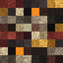 `ghoul_trophy`  
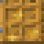 `golden_door_bottom`  
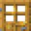 `golden_door_top`  
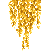 `golden_hanging_leaves`  
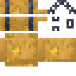 `golden_hanging_sign`  
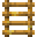 `golden_ladder`  
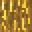 `golden_log`  
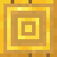 `golden_log_top`  
 `golden_petals`  
 `golden_petals_stem`  
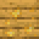 `golden_planks`  
 `golden_sapling`  
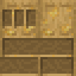 `golden_shelf`  
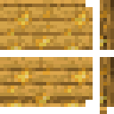 `golden_sign`  
 `golden_torch`  
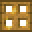 `golden_trapdoor`  
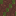 `improved_flesh_block`  
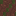 `rotten_flesh_block`  
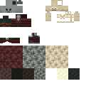 `skeleton_trophy`  
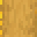 `stripped_golden_log`  
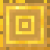 `stripped_golden_log_top`

[Accueil du wiki](../README.fr.md)
